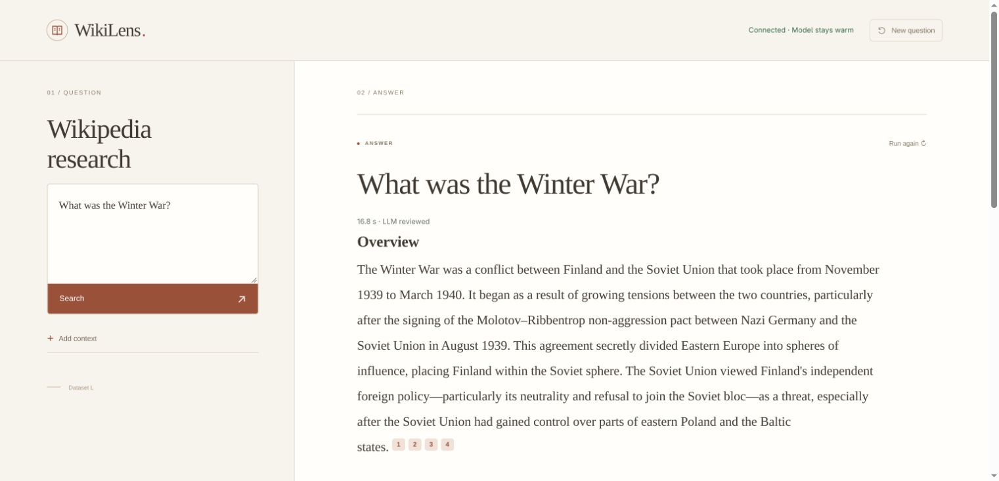

# WikiLens

**A retrieval–generation pipeline over 568,416 Finnish Wikipedia articles, using MariaDB native vector search.** Built by Petteri Hallipelto for the MariaDB RAG challenge at Junction 2026.

WikiLens turns a question and optional context into a readable article with inspectable source passages. It combines structured HyDE, BGE-M3 embeddings, MariaDB vector retrieval, passage reranking, Qwen generation, a second LLM review, and post-hoc citation selection. The Paper interface exposes the pipeline stages and an admin inspector for the retrieved documents.



## Try the presentation without cloud services

From this directory, with Python 3.12:

```bash
python3 -m wikilens.recording --port 8040
```

Open [localhost:8040](http://127.0.0.1:8040/). Search **talvisota** with no context, then repeat with context **videopeli**. These are clearly labelled, unedited **recorded H100 runs**, with working citations. Playback makes no model or database calls and is not a live inference benchmark.

## Live demo

```bash
uv sync --locked
scripts/record-wikilens.sh --port 8041
```

The live command connects to an **already running** private Modal session described by ignored `data/modal-paper-live-job.json`. It requires Modal authentication and the prepared Dataset L database snapshot on the operator's Volume. It does not start paid compute. Follow [the demo runbook](docs/recording-demo.md) for session startup, status, collection and shutdown.

The GPU, vLLM server, embedding model, reranker and MariaDB database stay resident between questions. The current six-hour H200 session has a hard deadline; closing a browser does not stop it. Answer language comes from the same Pydantic-structured response that produces HyDE, without another detection call. The retrieval corpus remains Finnish.

## Inspect the work

- [Pipeline and citation implementation](docs/architecture.md)
- [Measured results and limitations](docs/experiments.md) · [machine-readable measurements](reports/metrics.json)
- [Dataset preparation and reproduction](docs/full-l-embeddings.md)
- [Presentation deck](reports/wikilens-pipeline-pitch.pptx) · [PDF](reports/wikilens-pipeline-pitch.pdf) · [spoken script](pipeline-pitch-script.txt) · [video brief](demo-brief.md)
- [Submission description](docs/submission.md)

Citation badges show each source once per paragraph. Click one to see all its quoted excerpts for that paragraph.

Click **Admin** in the live UI to set the score cutoff, optional relative gap, retrieved article count, maximum selected passages and article output token budget. Changes apply to the next question. The document inspector shows retrieved articles, original text, passage scores, rejected passages and passages selected for generation. These are raw reranker scores, not probabilities. This is a local operator panel, not a production authentication system.

## Source layout

| Path | Purpose |
| --- | --- |
| `wikilens/` | Retrieval, generation, review, provenance, runtime adapters and interfaces |
| `wikilens/recording_ui/` | Paper UI, admin inspector and recorded fallback examples |
| `scripts/` | Dataset preparation, bounded Modal jobs and experiment reproduction |
| `inference/vllm/` | Separately locked H100/vLLM inference environment |
| `notebooks/` | Restartable pipeline and optional research interfaces; outputs cleared |
| `tests/` | Mocked inference, provenance, settings and local HTTP checks |
| `reports/` | Selected measurements, screenshots and presentation deliverables |

Install developer dependencies with `uv sync --locked --group dev`; run `.venv/bin/python -m pytest -q`. Tests do not start paid GPU jobs or train models. With Node.js installed, run `node tests/test_citation_groups.cjs` for the citation grouping checks. The optional Gradio interface uses `uv sync --locked --group demo` and `scripts/run-gradio-demo.py`.

## What the evidence does and does not establish

Observed warm end-to-end runs took **16.8 seconds in English** and **20.6 seconds in Finnish**, excluding startup. These are individual observations, not a latency guarantee or a quality benchmark. A separate comparison of frozen prompts and passages measured the combined change from L40S/Transformers to H100/vLLM; it does not isolate GPU effects.

The LLM reviews the draft **before** citation attachment. Citation selection is followed by Python checks that the selected quotation exists in the stored source passage. There is no final LLM audit of the fully cited article. Literal quotation provenance does not prove that the surrounding claim is supported. Generated articles can still contain factual and Finnish-language errors; the saved examples preserve those errors.

Source code is [MIT licensed](LICENSE). Wikipedia content and derived vectors retain their own attribution and CC BY-SA 4.0 terms; see [third-party notices](THIRD_PARTY_NOTICES.md). Dataset files, model weights, credentials, compute ledgers, raw logs and the pre-cleanup archive are excluded from Git. Public recorded examples contain attributed Wikipedia excerpts, not the full corpus.
