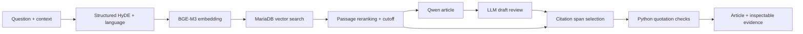

# Retrieval to generated article

1. **Question and optional context.** The original question remains distinct from the user's intended focus.
2. **HyDE and answer language.** Qwen returns a Pydantic-constrained object with `hypothetical_passage`, then nullable `language`. The hypothetical passage stays Finnish for retrieval; only that passage is embedded. The answer language follows the question, with Finnish fallback. HyDE is never source evidence.
3. **MariaDB native vector retrieval.** BGE-M3 embeds the retrieval passage. MariaDB searches the indexed, verified 1024-dimensional vectors for Dataset L articles. Page/revision identities travel with each article.
4. **Passage selection.** Articles are split into source-aligned passages. BGE reranker v2-m3 scores them, applies the cutoff and optional relative gap, then packs the selected passages into the context budget. For non-Finnish questions the reranking query includes a bounded Finnish HyDE hint. Context helps disambiguate a name such as talvisota.
5. **Generation and review.** Qwen generates an article from the actual selected passages. Another call reviews and revises it for source fidelity and language. Both raw drafts are retained.
6. **Citations and provenance.** The reviewed article is divided into citation units. The model proposes source spans; Python checks the literal quotations and source offsets. The UI links each quotation to the stored Wikipedia revision.

## Implementation map

- `hyde_search.py`: Finnish HyDE prompt and `HyDEWithLanguage` schema.
- `gradio_demo.py`: resident `ProductEngine` orchestration, shared by the live Paper worker.
- `reranker_policy.py`, `reranker_comparison.py`, `focus_evidence.py`: passage scores and selection.
- `finnish_prompts.py`, `text_review.py`: article and review prompts.
- `paragraph_citations.py`, `citation_pipelines.py`: post-hoc citation selection.
- `vllm_runtime.py`: bounded requests to the resident vLLM server.
- `admin_tools.py`: validated request settings and retrieval diagnostics.
- `paper_live.py`, `recording.py`: private Modal bridge and loopback HTTP interface.
- `scripts/run-paper-live.py`: owns or attaches to the resident inference services.

The older citation-aware and structured-claim variants remain as reproducible source. The presentation's live path uses draft → review → post-hoc citations. No model training or fine-tuning is performed.

## Runtime and controls

The current demo uses one H200 with Qwen3-4B-Instruct-2507-FP8, BGE-M3 and BGE-reranker-v2-m3. Earlier measurements used one H100 80 GB. The six-hour H200 profile preserves the same prompts, pinned model and vLLM settings. The current default context budget is 12,288 tokens. The two locked Python environments deliberately separate legacy Transformers experiments from vLLM inference.

Defaults exposed in Admin: absolute reranker cutoff −2, relative gap disabled, 60 retrieved articles, up to 25 selected passages, and 4,000 article output tokens. The review budget remains fixed. Invalid settings are rejected before queuing. Diagnostics survive an empty selection so rejected documents remain inspectable. The inspector distinguishes retrieved, cutoff-passing and actually selected passages.

The local server accepts submissions from localhost and checks origins; it is not a public multi-user deployment. The browser cannot allocate a GPU. Each paid session has an explicit reservation, timeout and one attempt. Loading another question reuses the resident models and database.

## Limits

Quotation existence is mechanically checked; semantic support is not independently certified. The review runs before citations are attached, and can leave mistakes unchanged. A lack of matching passages is not evidence that the answer does not exist elsewhere. HyDE and language detection can be wrong. The corpus is a fixed Finnish dataset release, not live Wikipedia. Retrieved language and answer language are different concepts.

## Citation display

The Paper interface groups references by Wikipedia revision within each paragraph.
Each distinct source gets one badge per paragraph, with stable source numbering
across the article. Opening a badge lists every distinct exact quotation linked
to that source in that paragraph. Identical quotations are shown once; original
reference IDs and source-passage IDs are retained in the display model. Quotations
from other paragraphs are kept separate, and different revisions are not merged.
This is a presentation transform over the unchanged raw evidence; it adds no
model call and does not restart inference services.
